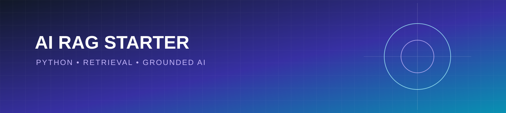

<p align="center"></p>

# AI RAG Starter Python

A practical, beginner-friendly Retrieval-Augmented Generation (RAG) starter built with Python. The project demonstrates document loading, text chunking, simple retrieval, and a clean path toward connecting an LLM.

## Why this project exists

RAG systems combine search with language models so answers can be grounded in a trusted document collection. This repository focuses on understandable building blocks rather than hidden magic.

## Features

- Local text-document ingestion
- Lightweight keyword retrieval with no paid API
- Clear interfaces for replacing retrieval with embeddings or a vector database
- Unit tests and a small command-line demo
- Privacy-friendly local-first workflow

## Quick start

```bash
python -m venv .venv
source .venv/bin/activate  # Windows: .venv\\Scripts\\activate
pip install -r requirements.txt
python -m src.rag_demo
pytest -q
```

## Project structure

```text
src/
  rag_demo.py
  __init__.py
tests/
  test_rag_demo.py
requirements.txt
```

## Roadmap

- [ ] Add semantic embeddings
- [ ] Add persistent vector storage
- [ ] Add citation-aware answer generation
- [ ] Add evaluation datasets and retrieval metrics
- [ ] Add a FastAPI endpoint

## Responsible use

Validate retrieved sources, protect sensitive documents, and do not treat generated text as authoritative without human review.

## License

MIT License. See [LICENSE](LICENSE).
